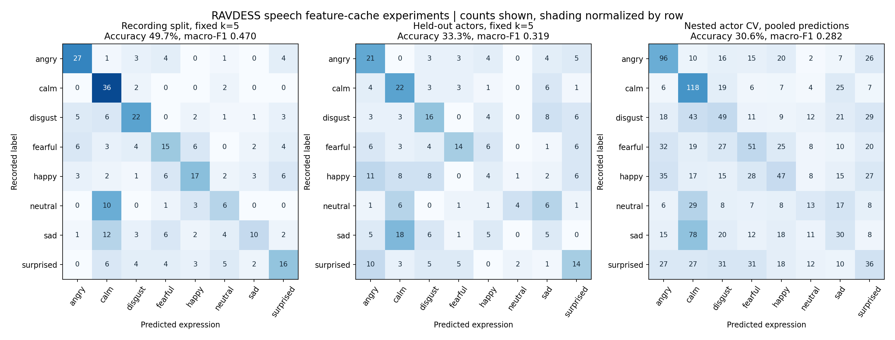

# Speech Emotion Recognition with MiniLearn

I built MiniLearn to understand how machine learning algorithms work. It implements classifiers, preprocessing, metrics, PCA and clustering in NumPy. I used KNN to classify acted vocal expressions from RAVDESS using features such as MFCCs, chroma and Mel spectra.

My original recording split included the same actors in training and testing. When I held out entire actors with the same KNN settings and class counts, accuracy dropped from 49.67% to 33.33%. The evaluation below explains how I set up that comparison and tuned the model without using the held-out speakers.

The project began in [sahamis/Project_CSE432-532](https://github.com/sahamis/Project_CSE432-532). The instructor supplied the brief and starter materials; the algorithm modules and analysis notebooks were added in my fork. [Provenance](docs/PROVENANCE.md) records that division, subsequent changes and the release scope. No source-code license has been assigned.

## What I implemented

MiniLearn includes one-vs-rest logistic regression with gradient descent, Euclidean KNN, Gaussian Naive Bayes, a linear hinge-loss SVM, Gini-based decision trees and a one-hidden-layer ReLU network. Standardization, stratified splits, actor-grouped folds and classification metrics support evaluation. PCA uses covariance eigendecomposition, while KMeans alternates assignments and centroid updates.

The algorithms remain NumPy implementations. Scikit-learn provides reference comparisons in tests and checks the KNN experiment predictions. The real-data results below evaluate KNN; the other classifiers have synthetic correctness tests rather than a newly rerun RAVDESS benchmark.

The review reproduced and fixed shuffled-CV failures, sigmoid overflow, zero-variance Naive Bayes, incorrect KMeans inertia and PCA boundary cases. It also corrected mixed-label metric handling, missing actor IDs and malformed CV partitions. Tests now include a numerical gradient check for the neural network and a check that changing held-out features cannot affect tuning. See the [engineering review](docs/ENGINEERING_REVIEW.md).

## Recording splits and unseen speakers

The main experiments use the same recovered cache of **1,440 speech recordings, 24 actors and 724 acoustic features**. The matched comparison fixes k=5, uses 1,140 training and 300 test recordings on both sides, and matches every class count. Both fit their scaler only on training data. Membership and speaker overlap differ by design.

| Cached-feature experiment | Accuracy | Macro-F1 | Actors shared across each outer split |
| --- | --- | --- | --- |
| Matched recording split, fixed k=5 | 49.67% | 0.4701 | 24 |
| Matched actor holdout, fixed k=5 | 33.33% | 0.3185 | 0 |
| Six-fold nested actor CV, pooled predictions | 30.56% | 0.2823 | 0 |

Nested CV holds out four actors per outer fold. Within the other 20 actors, four grouped folds select k from 1, 3 and 5 by macro-F1. Scaling is fitted separately in each training fold. Every recording receives one outer test prediction, and all predictions match scikit-learn. Outer accuracy ranges from 25.83% to 35.00%; its fold standard deviation is 3.72 percentage points, not a population confidence interval.

The matched gap is consistent with the recording split being an easier familiar-speaker task. It does not isolate a causal amount of speaker leakage, since the recording membership still differs. These are development experiments on a previously explored dataset, not an external blind benchmark. The earlier 58.60% recording result used a separately tuned k=1 and 285 test rows; it is retained as a historical cached experiment rather than the matched comparison.



The figure shows genuine counts, with row-normalized shading. The nested matrix pools the six outer folds. [Evaluation details](docs/EVALUATION.md) include class counts, actor assignments, seeds and limitations. The [aggregate result JSON](docs/results/summary.json) contains the recorded measurements without audio, features or individual predictions.

## Data and acoustic features

[RAVDESS](https://zenodo.org/records/1188976), by Steven R. Livingstone and Frank A. Russo, contains speech and song recordings. These experiments use speech only, with eight expression labels. Neutral has 96 recordings and each other class has 192. Song has different class coverage and is excluded from the reported benchmark.

The extractor summarizes 12 MFCCs, first and second MFCC deltas, chroma, a 128-band Mel spectrogram, zero-crossing rate, RMS energy, spectral centroid, bandwidth and rolloff. Mean, standard deviation, minimum and maximum yield 724 numeric features. Audio stays at its native sample rate and is converted to mono; framing uses 2,048 samples with a 512-sample hop. No actor, filename, emotion or other metadata enters the model. The feature schema is predefined, with no learned feature selection in this benchmark.

The full audio-to-cache rebuild remains unverified. The earlier pass checked synthetic audio and eight resident recordings against the cache, but 1,588 original WAV entries are cloud placeholders. The numerical experiments have been rerun and repeated on the cached input; that is distinct from regenerating every feature from authenticated source audio.

## Setup and tests

From the repository root, using CPython 3.12 or 3.13:

```sh
python3.12 -m venv .venv
source .venv/bin/activate
python -m pip install -r requirements-verified.txt
python -m unittest discover -s tests -v
```

All **49 tests pass** on macOS with Python 3.12, in local Linux containers with Python 3.12 and 3.13, and in [GitHub Actions on Ubuntu with Python 3.12 and 3.13](https://github.com/daley-tyler/speech-emotion-recognition/actions/runs/41158639939). Tests use synthetic data and generated WAV fixtures, so they need no RAVDESS download. SciPy 1.17.0 is pinned because the older wheel failed to load on this Mac. The environment snapshot includes the optional figure dependencies.

## Reproduce the experiments

With the same feature cache available locally:

```sh
python SER_Project/benchmark.py \
  --features /path/to/week5_audio.csv \
  --output SER_Project/results/benchmark.json \
  --summary SER_Project/results/summary.json \
  --require-complete-speech --seed 123

python tools/plot_results.py \
  --summary SER_Project/results/summary.json \
  --output-dir SER_Project/results/figures
```

The command reproduces the fixed-k comparison and nested actor CV. It checks that all 1,440 unique speech filenames are present and records split assignments, class counts, tuning scores, predictions, versions and input/source hashes. Existing result paths are rejected to preserve previous runs. The exact cache hash and optional raw-audio download, integrity-check and extraction procedure are in [reproducibility](docs/REPRODUCIBILITY.md). No audio download is automatic.

## Limits and attribution

RAVDESS is small, acted and limited to two statements. Unseen-actor evaluation does not establish performance on spontaneous speech, another language or another recording environment. MiniLearn has simple optimizers, one KMeans initialization and threshold-limited trees; its probability scores are not calibrated. Further work should prioritize verified audio regeneration and broader repeated speaker evaluation before more elaborate models.

This public snapshot excludes historical notebooks, paper PDFs, supplied assignment/setup text, the instructor's downloader, raw audio, feature tables and model artifacts. Original coursework and development history remain preserved separately and linked through [provenance](docs/PROVENANCE.md). The [dataset and reference notes](docs/DATA_AND_REFERENCES.md) credit the original papers and RAVDESS's CC BY-NC-SA 4.0 conditions. Publication does not grant broader reuse rights to excluded coursework or third-party materials.
