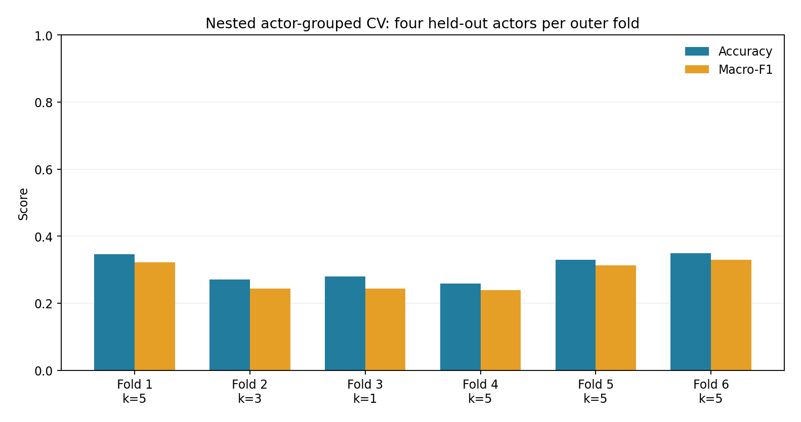

# Evaluation protocol and recorded results

The input is the recovered 2,452-row cache, SHA-256 `f8c2d3540992acac27e2d62a2d38a6049b9575ef547847bad4966a7f51c398fd`. Filtering to speech leaves 1,440 unique filenames, 24 actors and 724 acoustic features. The filename inventory matches the complete speech protocol. There are no duplicate filenames or nonfinite feature values. No learned feature selector, PCA or full-data normalization is used in these experiments.

## Matched comparison

Both runs use MiniLearn Euclidean KNN with k=5, training-fitted standardization, the same fixed feature schema and seed 123. There is no tuning in this comparison. Five actors, selected by a local NumPy generator, define the actor holdout. The recording split uses deterministic largest-remainder class quotas to match the test size and class distribution. It does not use predictions or accuracy to choose recordings. Both have 1,140 training and 300 test rows. The actor holdout is 3, 5, 11, 21 and 24; the recording split shares all 24 actors across its boundary.

| Label | Complete speech | Matched training | Matched test | Each outer CV training | Each outer CV test |
| --- | --- | --- | --- | --- | --- |
| Angry | 192 | 152 | 40 | 160 | 32 |
| Calm | 192 | 152 | 40 | 160 | 32 |
| Disgust | 192 | 152 | 40 | 160 | 32 |
| Fearful | 192 | 152 | 40 | 160 | 32 |
| Happy | 192 | 152 | 40 | 160 | 32 |
| Neutral | 96 | 76 | 20 | 80 | 16 |
| Sad | 192 | 152 | 40 | 160 | 32 |
| Surprised | 192 | 152 | 40 | 160 | 32 |

The fixed-k recording split reaches 0.496667 accuracy and 0.470107 macro-F1. The actor holdout reaches 0.333333 accuracy and 0.318525 macro-F1. Both match reference predictions exactly. The 16.33-point accuracy gap concerns these particular partitions and fixed classifier; it is not a causal estimate or a confidence interval. k=5 was retained from the earlier project settings before these reruns. The dataset and earlier holdout had already been explored, so the experiment is descriptive development evidence rather than a new blind test.

## Nested actor CV

Six outer folds split the 24 actors using seed 123. Each holds out four actors and 240 recordings, while training on 20 actors and 1,200 recordings. Each recording is tested exactly once. Four inner group folds use seeds 124 through 129, respectively, to choose k from 1, 3 and 5 by mean validation macro-F1. Scaling is fitted inside each inner training fold and fitted anew on the full outer training partition afterward. No outer test data enters fitting or tuning.

| Outer fold | Held-out actors | Inner seed | Selected k | Accuracy | Macro-F1 |
| --- | --- | --- | --- | --- | --- |
| 1 | 3, 5, 21, 24 | 124 | 5 | 0.345833 | 0.322793 |
| 2 | 7, 8, 11, 23 | 125 | 3 | 0.270833 | 0.243346 |
| 3 | 1, 2, 9, 12 | 126 | 1 | 0.279167 | 0.243999 |
| 4 | 16, 19, 20, 22 | 127 | 5 | 0.258333 | 0.239073 |
| 5 | 10, 13, 17, 18 | 128 | 5 | 0.329167 | 0.313146 |
| 6 | 4, 6, 14, 15 | 129 | 5 | 0.350000 | 0.330156 |

Pooled outer predictions give 0.305556 accuracy, 0.282332 macro-F1 and 0.290713 weighted F1. The mean fold accuracy is also 0.305556 because the folds have equal sizes. Mean fold macro-F1 is 0.282085; it differs from pooled macro-F1 because F1 is nonlinear. Fold standard deviations are 0.037164 for accuracy and 0.040278 for macro-F1. They describe split variation, not independent standard errors or population confidence intervals. All outer predictions match scikit-learn KNN with the corresponding training data and selected k.

## Earlier results and remaining limits

The first pass's recording split used stratification with per-class rounding: 1,155 training and 285 test rows, selecting k=1 through recording-level training CV. It reached 0.585965 accuracy and 0.580495 macro-F1. Its actor split used 1,140/300 rows and group CV selecting k=5, reaching 0.333333 and 0.318525. Data and features were comparable, but model settings, sample counts and validation rules differed. Those runs were verified again; they remain valid cached experiments but should not be presented as a matched estimate of the effect of speaker overlap.

Original notebook outputs are a third category. The original final notebook shared all 24 actors and later performed full-data CV including its earlier holdout. Those saved model scores were not rerun or adopted as current results. Its supervised scaler/PCA and the separate weekly validation notebook did use training-only fitting; not all historical preprocessing was leaky.

The current benchmark's fixed feature schema was designed during exploratory coursework. A new dataset, speakers or recording environment would be needed for an external assessment. These experiments also do not rerun every MiniLearn classifier on RAVDESS or verify the complete raw-audio extraction history.

The aggregate JSON contains the input hash, complete class counts, settings, actor groups, inner scores, confusion matrices and source provenance. Per-record assignments and predictions are retained in the restricted local experiment record, outside the publication candidate. An independent check recomputed every metric using scikit-learn and verified outer/inner actor separation and exact validation coverage. A second complete cache run repeated all assignments, tuning results and predictions.
